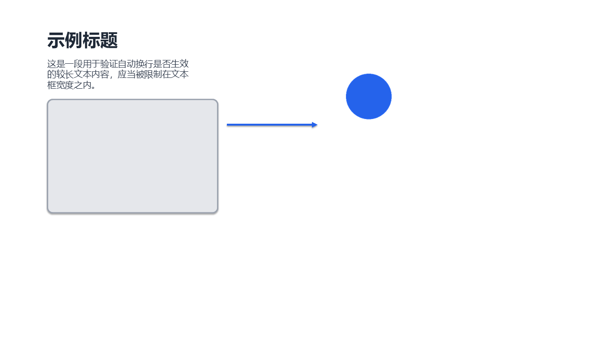
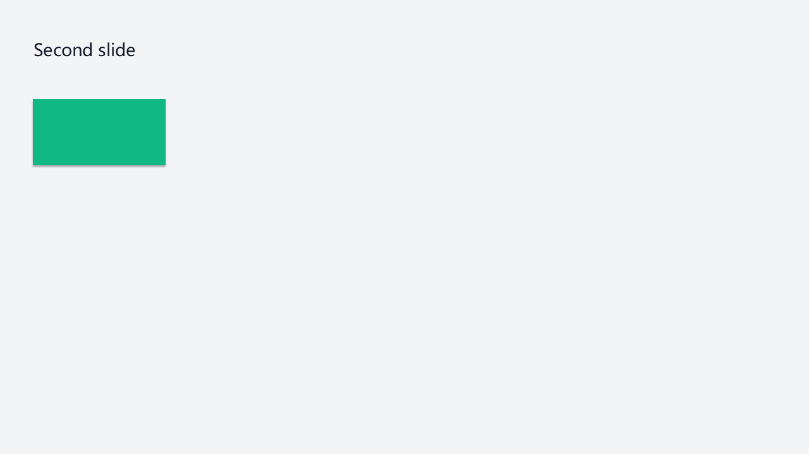

# wg-screenshot-to-ppt

把截图或图片转换成**可编辑的 PowerPoint（.pptx）**。标题、正文、色块、流程线、图标分别作为原生文本框、形状、连接线和独立图片写入，打开后可直接改文字、换填充色、移动箭头。

适用于课件、汇报、营销素材、操作教程，以及把已有幻灯片/流程图截图还原成可编辑稿。

## 效果截图

用测试清单生成的 2 页 16:9 成品，由 PowerPoint 实际渲染导出：

| 第 1 页 | 第 2 页 |
| --- | --- |
|  |  |

第 1 页包含：加粗标题、自动换行的长文本、圆角描边卡片、指向右侧的蓝色箭头、独立嵌入的圆形图标。第 2 页包含：浅灰背景、文本、绿色矩形色块。

对应的输入清单见 [`examples/manifest.json`](examples/manifest.json)，输出成品见 [`examples/sample-output.pptx`](examples/sample-output.pptx)。

## 安装

### 作为 WorkBuddy Skill 使用

把本仓库目录放到技能目录（用户级 `~/.workbuddy/skills/` 或项目级 `<workspace>/.workbuddy/skills/`），重启会话后即可调用：

```bash
git clone https://github.com/justin-yu-space/wg-screenshot-to-ppt.git ~/.workbuddy/skills/wg-screenshot-to-ppt
```

### 依赖

首选构建器 `build.py` 依赖 Python 3.9+ 与：

```bash
pip install python-pptx Pillow
```

可选构建器 `build.mjs` 依赖 Node.js 与 `@oai/artifact-tool`。该包是 OpenAI 内部依赖，通常无法从公共 npm 源获取，因此**一般使用 `build.py` 即可**。

## 使用

### 1. 写清单 JSON

清单描述每页画布与对象，坐标单位为 EMU（1 英寸 = 914400 EMU；按 96 DPI 换算，1 像素 = 9525 EMU；1920×1080 像素 = 18288000×12192000 EMU）。

```json
{
  "width": 12192000,
  "height": 6858000,
  "font": "Microsoft YaHei",
  "slides": [
    {
      "background": "#FFFFFF",
      "objects": [
        { "type": "text", "name": "标题", "x": 952500, "y": 457200,
          "w": 10287000, "h": 685800, "text": "示例标题", "size": 28,
          "color": "#1F2937", "bold": true, "wrap": "square", "align": "left" },
        { "type": "shape", "name": "卡片", "x": 952500, "y": 1371600,
          "w": 3429000, "h": 2286000, "fill": "#E5E7EB", "stroke": "#9CA3AF", "radius": 152400 },
        { "type": "arrow", "name": "流程线", "x": 4572000, "y": 2514600,
          "w": 1828800, "h": 0, "color": "#2563EB", "head": "arrow" },
        { "type": "image", "name": "图标", "x": 6858000, "y": 1371600,
          "w": 1143000, "h": 1143000, "file": "icon.png" }
      ]
    }
  ]
}
```

对象通用字段：`name`、`x`、`y`、`w`、`h`。按类型补充：

| 类型 | 字段 |
| --- | --- |
| `text` | `text`、`size`（磅）、`color`，可选 `bold`、`wrap`（`square` 默认自动换行 / `none` 不换行）、`align`（`left`/`center`/`right`）、`valign`（`top`/`middle` 默认/`bottom`） |
| `shape` | `fill`，可选 `stroke`（六位 HEX）、`radius`（EMU 圆角半径） |
| `arrow` | `color`，可选 `head`（`arrow` 默认 / `triangle` / `stealth` / `diamond` / `oval` / `none`）；终点为 `(x+w, y+h)` |
| `image` | `file`：相对清单目录的图片路径，支持 PNG/JPG/JPEG/GIF/BMP/WEBP |

颜色统一为六位 HEX（可带 `#`），`none` 或 `null` 表示无填充。

### 2. 构建 PPTX

```bash
python scripts/build.py 清单.json 成品.pptx
```

清单校验内置：字段缺失、类型错误、数值非法、图片路径逃逸清单目录或文件不存在，都会报出可定位到 `slides[i].objects[j]` 的错误。

Node 版（仅在 `@oai/artifact-tool` 可解析时）：

```bash
node scripts/build.mjs 清单.json 成品.pptx
```

两个构建器接受同一份清单格式，输出等价的可编辑对象。

### 3. 裁切图标（可选）

`crop_icon.py` 用 Pillow 裁切透明 PNG，可对单色图标按背景色/前景色恢复边缘透明度：

```bash
python scripts/crop_icon.py source.png icon.png --box 10 20 64 64 --background FFFFFF --foreground 2563EB --size 128
```

`--box x y w h` 为裁切区域；`--size` 输出方形画布边长（1–4096）。

## 文件说明

| 路径 | 用途 |
| --- | --- |
| `SKILL.md` | WorkBuddy 技能定义与还原/核对流程 |
| `scripts/build.py` | 首选构建器（python-pptx） |
| `scripts/build.mjs` | 备选构建器（@oai/artifact-tool） |
| `scripts/crop_icon.py` | 图标裁切与透明背景恢复 |
| `examples/` | 示例清单、图标与输出成品 |
| `screenshots/` | 效果截图 |
